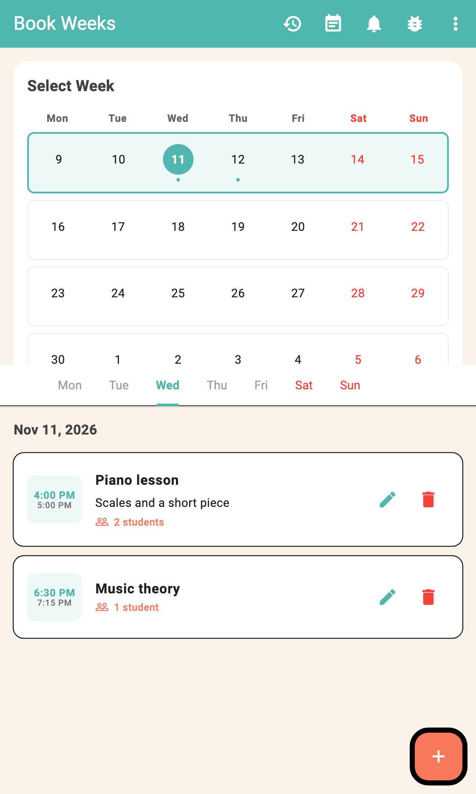
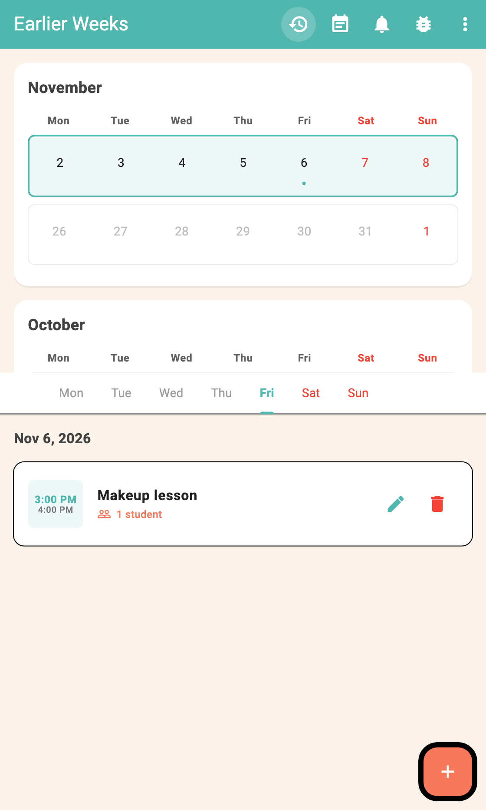
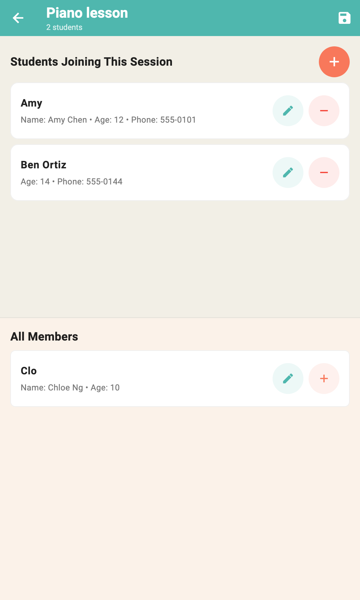
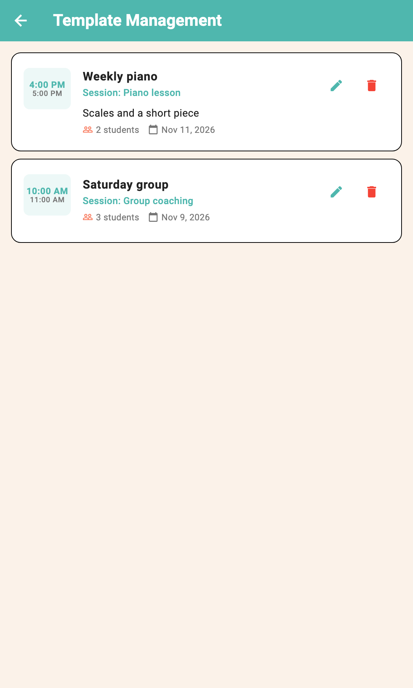
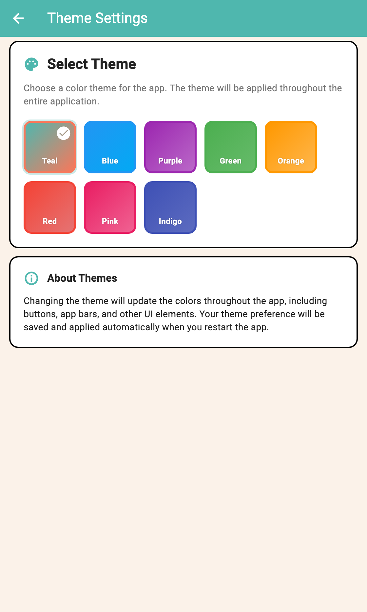

# Book Weeks

A Flutter app for tutors, coaches, and educators to manage weekly class schedules and student rosters. Plan the weeks ahead, add lessons on days that have already passed, look back through earlier months, and keep students, templates, and reminders together on the device.

**Version:** 1.0.8

## Features

- **Week calendar** — See the next four weeks, with a dot on days that have sessions. Every day of the selected week stays in the tabs, including days before today, so a lesson can be added after the fact
- **Earlier weeks** — Open past months from the history button. The latest month is at the top. Older loads the previous three months
- **Sessions** — Create and edit a class with a title, time range, and description. All Events lists the newest session first and loads the next 20 older ones as you scroll
- **Students** — Keep a roster (name, nickname, age, phone) and assign people to a session
- **Templates** — Save a session, including its student list, and create the next one from that template
- **Reminders** — A local notification can fire at the start of a session or 1 minute, 5 minutes, 30 minutes, 1 hour, or 6 hours before. iOS, Android, Windows, and macOS schedule that with the system. Linux shows it while Book Weeks is open. The web app does not deliver reminders
- **Themes** — Choose a color theme. The choice is saved on the device
- **Backup** — Export and import sessions, students, and templates as YAML
- **Localization** — UI strings for many locales, using the system language when a translation is available

Data stays on the device. Nothing is sent to a remote server unless you export a file yourself.

## Screenshots









## Getting started

### Prerequisites

- [Flutter](https://docs.flutter.dev/get-started/install) (SDK compatible with `^3.10.4` — see `pubspec.yaml`)
- Xcode (iOS/macOS) and/or Android Studio / SDK (Android), as needed for your target

### Run

```bash
flutter pub get
flutter run
```

iOS, Android, web, Linux, macOS, and Windows projects are in the repo. Pick a device with `flutter devices`, then for example `flutter run -d chrome`, `flutter run -d macos`, `flutter run -d windows`, or `flutter run -d linux`.

Generate localizations after editing ARB files under `l10n/`:

```bash
flutter gen-l10n
```

### Build

```bash
# iOS
flutter build ios

# Android
flutter build apk
# or
flutter build appbundle
```

Pushes to `main` publish the web app with **Deploy Flutter Web to GitHub Pages** at https://iravan.github.io/bookweeks/. The same push builds an Android APK and Linux, Windows, and macOS apps, and compiles the iOS app without signing. Download the installable builds from the **Build Android, desktop, and macOS** workflow artifacts. The Linux artifact includes a tarball plus a `.deb` for Debian and Ubuntu and a `.rpm` for Fedora and RHEL. The macOS app is unsigned. The APK is signed with the debug key so it can be installed without a Play Store upload key. The iOS check only confirms the project compiles. A signed IPA still has to be built on a Mac with your Apple certificate.

## Project structure

```
lib/
  main.dart                 # App entry, home calendar + menus
  models/                   # Session, Student, Week, SessionTemplate
  services/                 # Persistence, notifications, themes, export/import
  widgets/                  # Screens and dialogs
  l10n/                     # Generated localization code
l10n/                       # Source .arb translation files
assets/
  icon/                     # App icon source
  sounds/                   # Notification sounds
```

## Tech notes

| Area | Approach |
|------|----------|
| Storage | `shared_preferences` for settings and app data |
| Backup format | YAML via `export_import_service` |
| Notifications | `flutter_local_notifications` + `timezone` |
| Theming | `ThemeService` with selectable light palettes |
| i18n | Flutter gen-l10n (`l10n.yaml`) |

For App Store copy, and the web app title, description, and keywords, see [`APP_STORE_LISTING.md`](APP_STORE_LISTING.md). Custom notification sound setup is documented in [`CUSTOM_NOTIFICATION_SOUND.md`](CUSTOM_NOTIFICATION_SOUND.md).

## Privacy

Book Weeks does not collect or transmit personal data. Sessions, students, and preferences remain on the device. Export/import is user-initiated only.

## License

Private project (`publish_to: 'none'`). Add a license here if you open-source or distribute the code.
