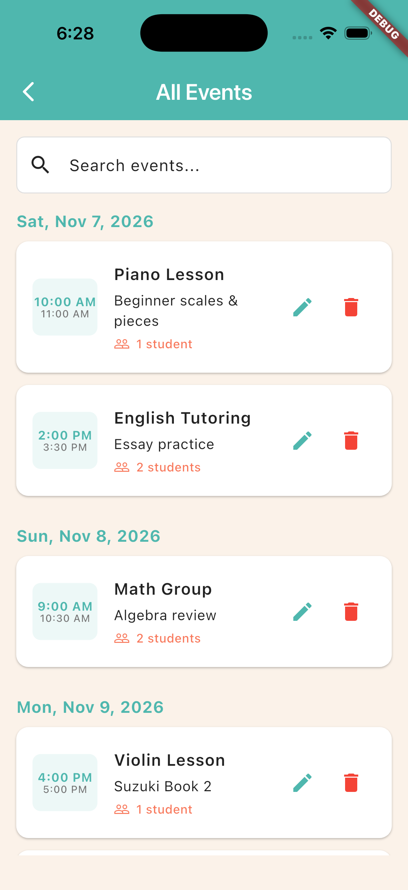
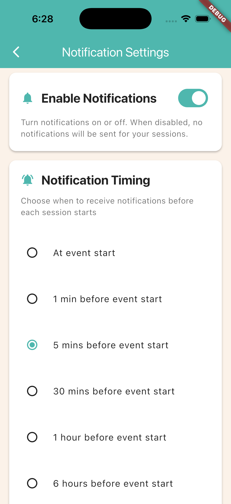

# Book Weeks

A Flutter app for tutors, coaches, and educators to manage weekly class schedules and student rosters. Plan sessions on a week calendar, track who’s attending, reuse templates for recurring classes, and get reminders before each session — all stored locally on device.

**Version:** 1.0.8

## Features

- **Week calendar** — Browse weeks at a glance, see which days have sessions, and jump into day tabs for the selected week
- **Sessions** — Create and edit classes with title, time range, and description; search everything in an all-events list
- **Students** — Keep a roster (name, nickname, age, phone), assign people to sessions, and manage attendance from the session view
- **Templates** — Save common sessions (including student lists) and create new ones from a template in one step
- **Reminders** — Local notifications before sessions, with configurable lead time (at start, 1 / 5 / 30 min, 1 h, or 6 h)
- **Themes** — Switch between built-in color themes; choice is saved on device
- **Backup** — Export and import all data as YAML for backup or moving between devices
- **Localization** — UI strings for many locales (system language when available)

Data stays on the device. Nothing is sent to a remote server unless you export a file yourself.

## Screenshots




## Getting started

### Prerequisites

- [Flutter](https://docs.flutter.dev/get-started/install) (SDK compatible with `^3.10.4` — see `pubspec.yaml`)
- Xcode (iOS/macOS) and/or Android Studio / SDK (Android), as needed for your target

### Run

```bash
flutter pub get
flutter run
```

Generate localizations after editing ARB files under `l10n/`:

```bash
flutter gen-l10n
```

### Build

```bash
# iOS
flutter build ios

# Android
flutter build apk
# or
flutter build appbundle
```

## Project structure

```
lib/
  main.dart                 # App entry, home calendar + menus
  models/                   # Session, Student, Week, SessionTemplate
  services/                 # Persistence, notifications, themes, export/import
  widgets/                  # Screens and dialogs
  l10n/                     # Generated localization code
l10n/                       # Source .arb translation files
assets/
  icon/                     # App icon source
  sounds/                   # Notification sounds
```

## Tech notes

| Area | Approach |
|------|----------|
| Storage | `shared_preferences` for settings and app data |
| Backup format | YAML via `export_import_service` |
| Notifications | `flutter_local_notifications` + `timezone` |
| Theming | `ThemeService` with selectable light palettes |
| i18n | Flutter gen-l10n (`l10n.yaml`) |

For App Store copy, see [`APP_STORE_LISTING.md`](APP_STORE_LISTING.md). Custom notification sound setup is documented in [`CUSTOM_NOTIFICATION_SOUND.md`](CUSTOM_NOTIFICATION_SOUND.md).

## Privacy

Book Weeks does not collect or transmit personal data. Sessions, students, and preferences remain on the device. Export/import is user-initiated only.

## License

Private project (`publish_to: 'none'`). Add a license here if you open-source or distribute the code.
